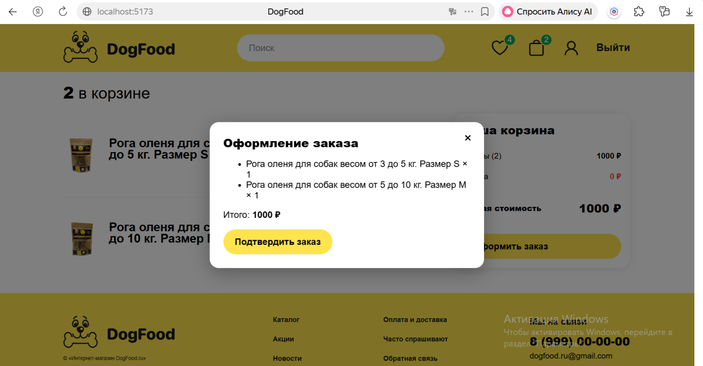
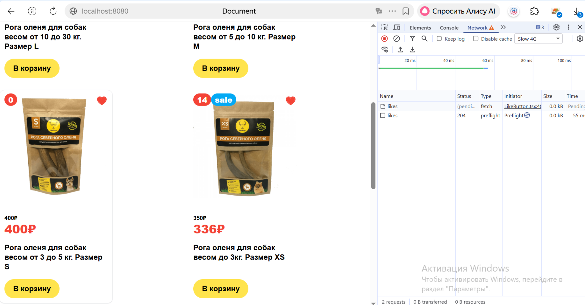
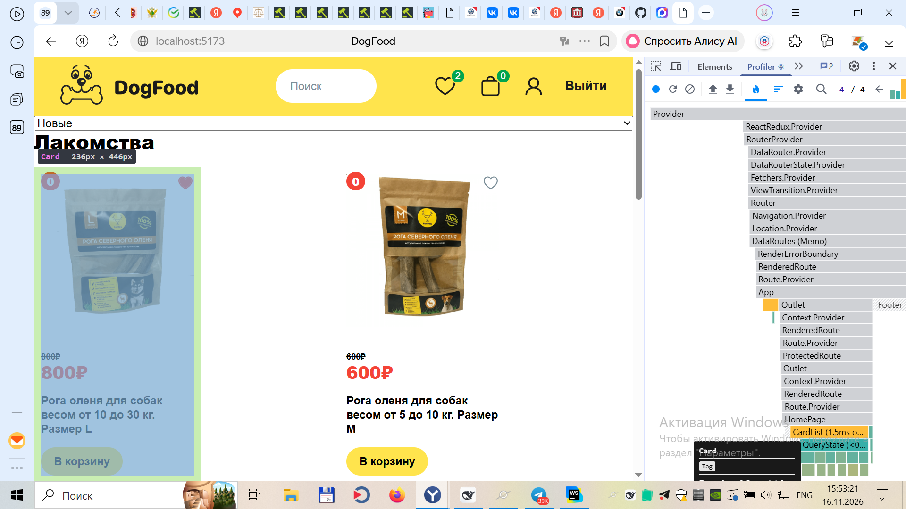
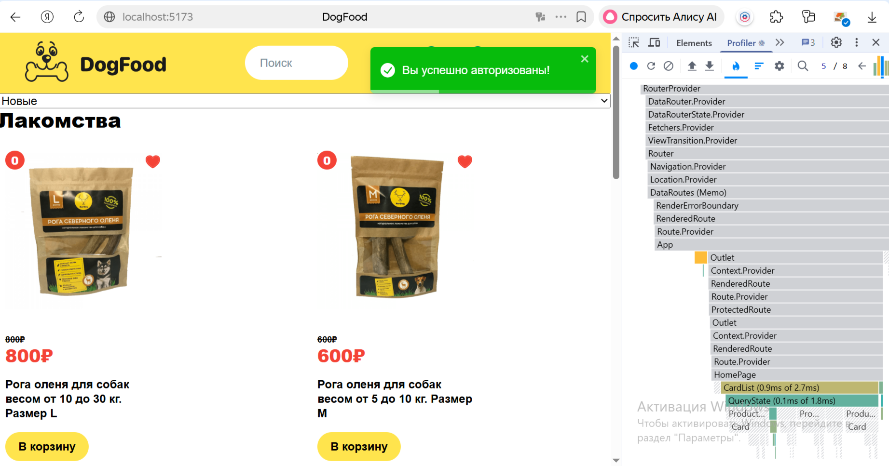
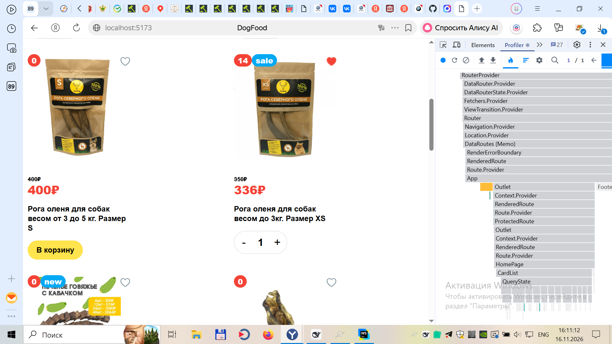
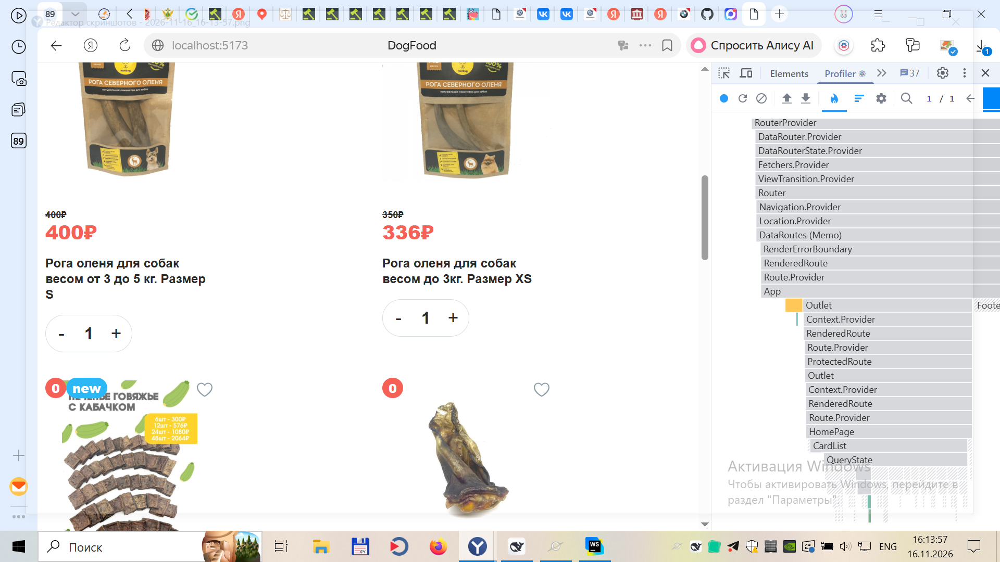

# Интернет-магазин DogFood — финальный проект

Учебный проект на React: каталог товаров с поиском, сортировкой и infinite scroll, карточка товара, избранное, корзина, авторизация/регистрация и профиль. Основная задача — не переписать приложение с нуля, а улучшить стартовый проект: привести код к понятной архитектуре, оптимизировать рендеры и добавить современные возможности React.

---

## Стек

- **React 19**, **TypeScript**
- **Redux Toolkit** + **RTK Query**
- **React Router v6**
- **React Hook Form** + **Yup**
- **MUI v5**
- **Webpack** (основная сборка), **Vite** (альтернативная сборка)
- **ESLint**, **Prettier**, **Stylelint**

---

## Что сделано (по шкале оценивания)

### 1. Архитектура и структура — 4 балла

- [x] `shared/ui` — только презентационные компоненты, без стора и API
- [x] изоляция фич по папкам, слои `shared/`, `features/`, `pages/` соблюдены
- [x] устранены лишние prop-chains

### 2. Оптимизация рендеров — 4 балла

- [x] Profiler: найден hotspot (`AddToCartButton`) и описан кратко
- [x] уместный `React.memo`
- [x] точечный `useCallback` для колбэков в списках

### 3. React.Portal (модалка, доступность) — 3 балла

- [x] портал работает, `#modal-root` добавлен, ESC/overlay обрабатываются
- [x] корректный фокус: установка при открытии, возврат на триггер

### 4. useRef — 2 балла

- [x] хранение состояния между рендерами без лишних рендеров
- [x] автофокус / DOM-интеракция

### 5. Альтернативная сборка (Vite) — 2 балла

- [x] рабочая сборка
- [x] сравнение с Webpack в README (время/размер, краткий вывод)

### 6. React 19 hooks (`useOptimistic`) — 3 балла

- [x] реальный UX-кейс с одним из хуков
- [x] обработка ошибок / ресет / оптимистичность

### 7. README и демо — 2 балла

- [x] «Что сделано» + «Структура папок»
- [x] скриншот модалки и оптимистичного UI + цифры сравнения сборок

### Обязательные условия

- [x] проект собирается и запускается (Webpack и Vite)
- [x] портальная модалка (через `createPortal`) с работающим ESC/overlay
- [x] одна фича на React 19 (`useOptimistic`) на реальном UX-кейсе
- [x] README: «Что сделано», «Структура», сравнение сборок (цифры), демо-скрины

**Итого: 20/20 баллов.**

---

## Структура проекта

```text
src/
├── app/          # инициализация приложения, роутер, Redux Store
├── pages/        # страницы приложения
├── widgets/      # крупные переиспользуемые блоки (Header, CardList…)
├── features/     # бизнес-фичи приложения (auth, cart, products…)
├── entities/     # доменные сущности (product, user, cart)
└── shared/       # переиспользуемый код и UI
```

Каждый слайс (feature/entity/widget) имеет публичный `index.ts`; импорты между слайсами идут только через него.

---

## Оптимизация рендеров

**Hotspot (найден через React DevTools Profiler):** компонент `AddToCartButton` в списке товаров.

**Проблема.** Кнопка подписывалась на весь массив корзины:

```ts
const cartProducts = useAppSelector(cartSelectors.getCartProducts); // весь массив
const isInCart = cartProducts.some((p) => p.id === product.id);
```

При добавлении одного товара создавался новый массив → React-Redux видел новую ссылку → перерисовывались **все** кнопки «В корзину» в списке (N рендеров вместо одного).

**Решение:**

- `selectIsInCart(state, id)` — точечный селектор, возвращающий `boolean` (React-Redux сравнивает результат по `===`, поэтому перерисовывается только кнопка, чей флаг реально сменился);
- `selectCartProductById(state, id)` — точечный селектор для `CartCounter`;
- `selectCartTotals` через `createSelector` — сумма пересчитывается только при изменении корзины;
- в редьюсере `setCartProductCount` теперь меняется ссылка только у изменённого товара;
- `React.memo(ProductCard)` — карточка не перерисовывается, если `product` не изменился;
- `useCallback` в `useAddToCart` / `useLoadMore` — стабильные ссылки на обработчики.

**Результат.** Один клик «В корзину» перерисовывает **одну** кнопку вместо всех кнопок списка; при рефетче (например, после лайка) карточки не перерисовываются — за это отвечает `React.memo(ProductCard)`.

---

## Modal через React Portal

`src/shared/ui/Modal` рендерится через `ReactDOM.createPortal` в `#modal-root` (контейнер добавлен в `index.html`).

Реализовано:

- закрытие по `Escape`;
- закрытие по клику на overlay (с `stopPropagation` на содержимом модалки);
- **focus trap**: при открытии фокус уходит внутрь, `Tab`/`Shift+Tab` циклится внутри;
- при закрытии фокус возвращается на кнопку, которая открыла модалку;
- блокировка прокрутки страницы (`body.overflow = 'hidden'`).

Пример использования — «Оформить заказ» на странице корзины.

---

## useRef

1. **Хранение значения без перерендера** — `shared/hooks/usePrevious`: хранит предыдущее значение. Используется в `useProducts` для сброса страницы на первую при смене поиска/сортировки.
2. **Работа с DOM** — автофокус на поле email в форме логина (`inputRef` + `useEffect`); а также `dialogRef`/`onCloseRef` в `Modal` для управления фокусом.

---

## React 19: useOptimistic

Кнопка «В избранное» (`features/favorites/ui/LikeButton`) использует `useOptimistic`:

```ts
const [optimisticLiked, setOptimisticLiked] = useOptimistic(
	isLiked,
	(_current, next: boolean) => next
);
```

- при клике состояние переключается **сразу** (оптимистично), не дожидаясь ответа сервера;
- при успехе RTK Query перезапрашивает список и `useOptimistic` синхронизируется с сервером;
- при ошибке состояние откатывается, пользователь видит toast с сообщением.

---

## Сравнение сборок

Проект собирается двумя сборщиками:

| Сборщик | Команда | Build time | Размер build |
|---|---|---|---|
| Webpack (ts-loader) | `npm run build` | ~48 сек | ~740 KB (686 KB JS + 51 KB CSS) |
| Vite (`@vitejs/plugin-react` + `tsconfigPaths`) | `npm run build:vite` | ~5 сек | ~717 KB (665 KB JS + 39 KB CSS + ~13 KB svg) |

**Вывод:** Vite собирается примерно в 9–10 раз быстрее и даёт немного меньший бандл (в основном за счёт CSS).

Webpack собирает в `dist/`, Vite — в `dist-vite/`.

---

## Скрипты

| Команда | Назначение |
|---|---|
| `npm start` | Webpack dev-сервер |
| `npm run build` | Webpack production-сборка |
| `npm run dev:vite` | Vite dev-сервер |
| `npm run build:vite` | Vite production-сборка |
| `npm run preview` | Vite: посмотреть prod-сборку |
| `npm run lint` | ESLint (с `--fix`) |
| `npm run stylelint` | Stylelint |
| `npm run format` | Prettier |

---

## Запуск

```bash
npm ci
# Webpack
npm start            # http://localhost:8080

# Vite
npm run dev:vite     # http://localhost:5173
```

---

## Демонстрация

### 1. Модальное окно (React Portal)

Открытие, закрытие по `Escape` и клику по overlay.



### 2. Оптимистичный UI — лайк в избранное (`useOptimistic`)

Сердечко закрашивается сразу, не дожидаясь ответа сервера; при ошибке — откатывается обратно.



### 3. Оптимизация рендеров

**Сравнение `ProductCard` с `React.memo` и без:**

- Без memo — перерисовывается весь список:

  

- С memo — карточки не перерисовываются при перерендере списка (в Profiler — «Did not render»):

  

**Сравнение `AddToCartButton`:**

- До оптимизации — перерисовываются все кнопки «В корзину» в списке:

  

- После оптимизации — перерисовывается только одна кнопка (кликнутая):

  